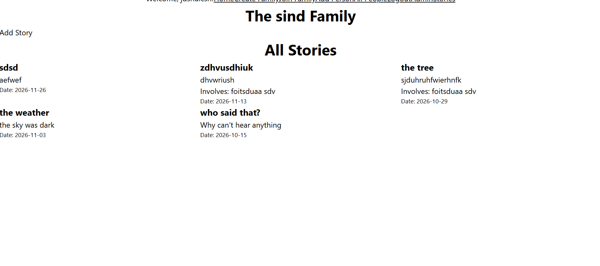
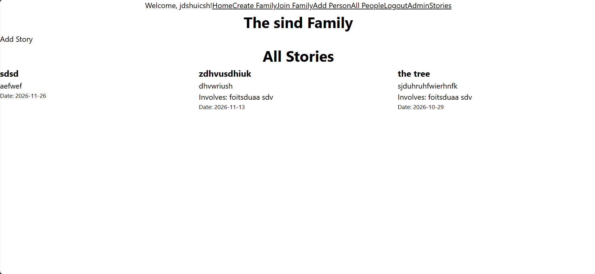
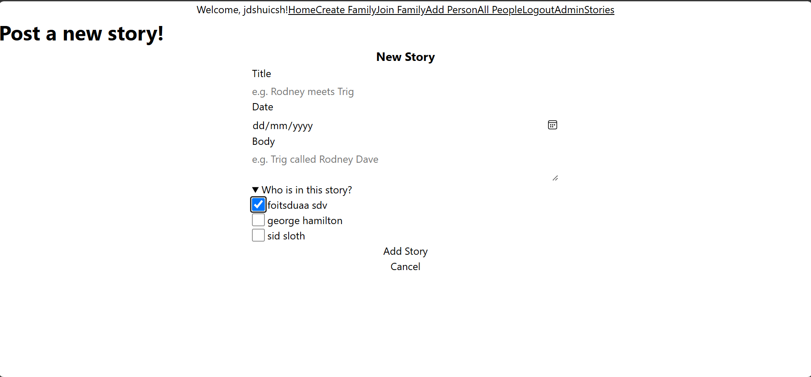
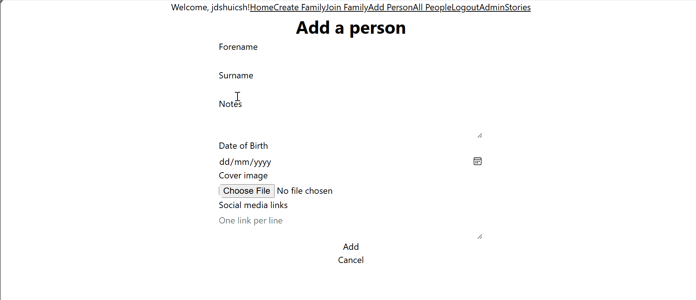

# Sprint 2 - Implement Database and Display of Test Data

## Sprint Goals

Implement the database, populated with test data. Create queries that retrieve test data, and display this on web pages as needed. Test and refine the queries and data display, so that it stands as the basis of the next sprint.

### Specific Goals

- Implement the database
- Add test data to the database
- Create the following web pages:
    - Home pages showing...
    - Details page for ...
    - Etc.
- Develop SQL database queries to:
    - Retrieve all ...
    - Retrieve specific ...
    - Etc.

## Testing Stories display

Seeing if stories display as they should by filtering by family. 

### Changes / Improvements

The stories are now filtered by family rather than all stories being printed even if they relate to other families. 

## Testing Tagging people in stories

I added a person, opened the new story form then checked whether their name showed on the story card. There was an issue because it showed people that weren't in the family which meant i hadn't filtered it properly. 

### Changes / Improvements

The people list on the story form is now limited to the chosen family

## Testing Adding person

Replace this text with notes about what you are testing, how you tested it, and the outcome of the testing

### Changes / Improvements

Images are now optionally added rather than required in case you don't have an image of the person on hand. 

## Testing pictures display

Adding a person, with an image, and seeing if it displays. 

### Changes / Improvements

I was saving the images to the wrong images file so when it targeted the correct folder in the all people code it didn't display it because there was nothing there. Changing the folder to the correct one saw the images get displayed.

## Sprint Review

**What went well** - This sprint made a working database of six linked tables (users, families, members, people, stories and involves).By storing the chosen family in the session and filtering every query by it means each family only sees its own stories and people, and the rest of the app builds on this. 

**Not so well** - A lot of time went into minor errors caused by redirects and broken links. 

