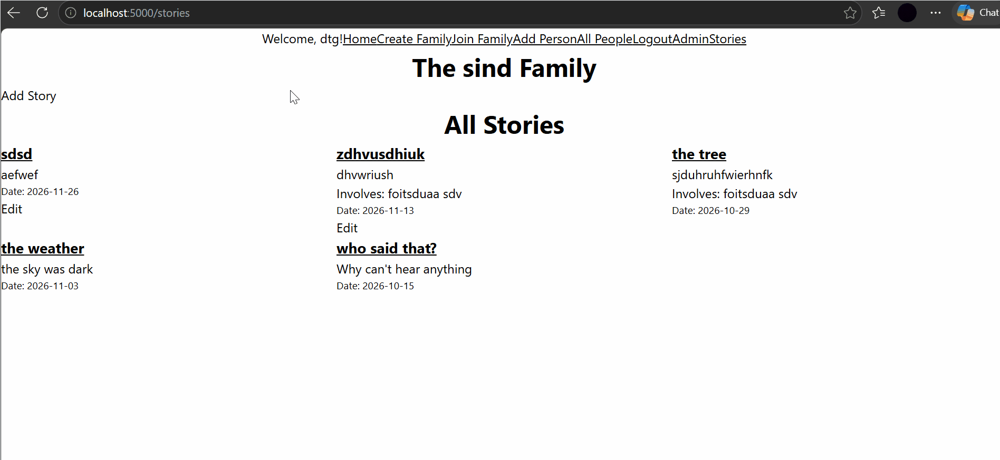
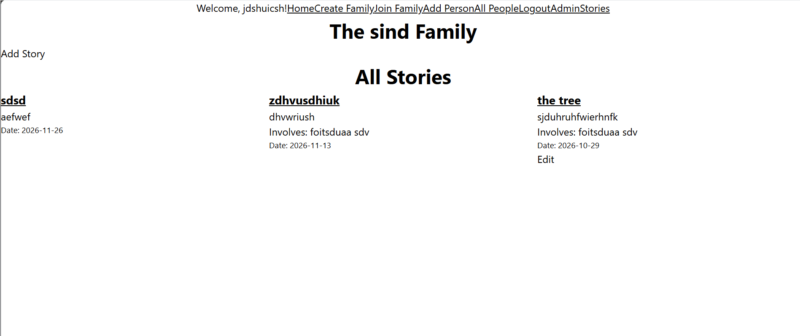
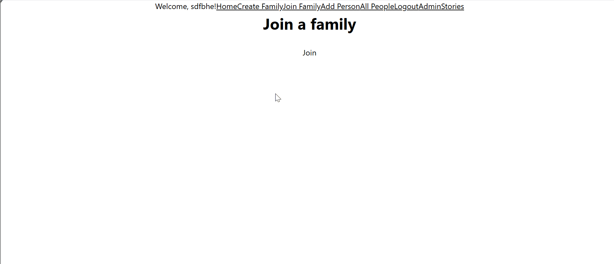
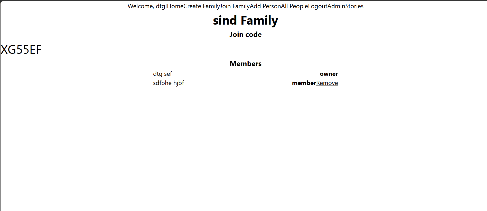
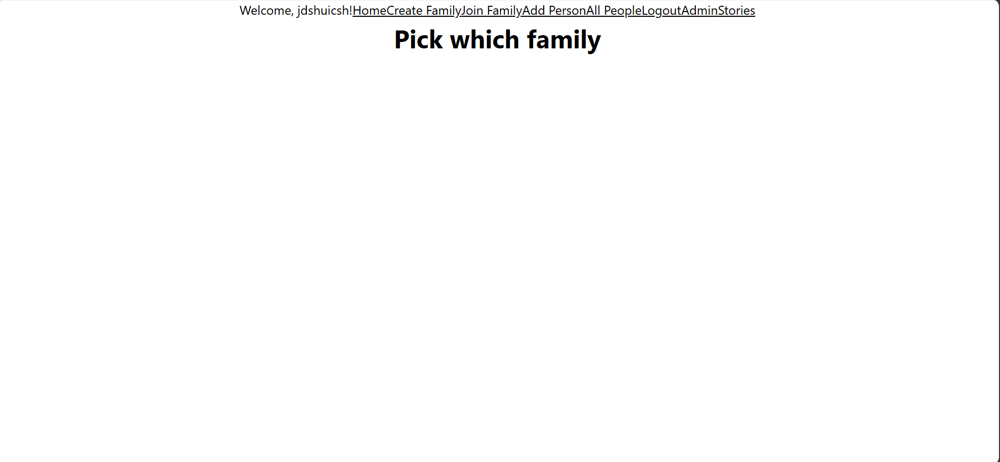

# Sprint 3 - Developing a Minimum Viable Product (MVP)

## Sprint Goals

Continue to develop the web application to the point that it provides all key functionality of the system. Test and refine it so that it can serve as the basis for the final phase of development.

### Specific Goals

- Create the following web pages:
    - Form for ...
    - Etc.
- Develop SQL database queries to:
    - Add a new ...
    - Etc.

## Testing access to other peoples stories

Type the story edit into the search bar for a story i didn't post (localhost:5000/story/5/edit). 

I got a flash message telling me i could only edit my stories. 

### Changes / Improvements

Worked as expected. 

## Testing Edit button 

After talking to my stakeholder, he suggested that an edit button rather than a link would be better to access the edit story form. This test checks whether that works. 

### Changes / Improvements

The title now links to a single story rather than the editing page. 

## Testing joining family

Testing whether you can join a family by entering a join code. 

It worked properly just needs some attention in css. 

### Changes / Improvements

The visual look of the form is terrible, i only knew where the input was because i had previously submitted the form and it gave me 'please fill out this field'. But css comes in the next sprint.  

## Testing removing member from family

Replace this text with notes any improvements you made as a result of the testing.

The member was removed successfully.

*Member that was removed view 

### Changes / Improvements

Worked as expected. 

## Sprint Review

This sprint moved the project from a site that displays data to a fully working app. Users can now add, edit and delete their own stories and people, tag people in stories and join or leave families. Checks were added so that typing an edit or delete URL for someone else's story is refused with an error message. I also made the image optional when adding a person, because the form used to reject anyone without a photo.

**Things that didn't go well** - Some bugs only showed up when testing with a second account, so I had to go back and fix routes I thought were finished.

