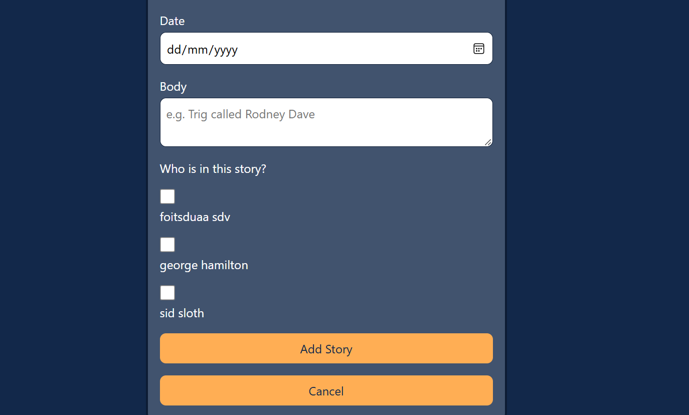
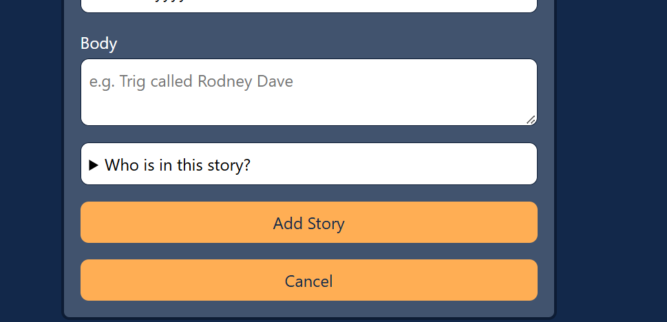
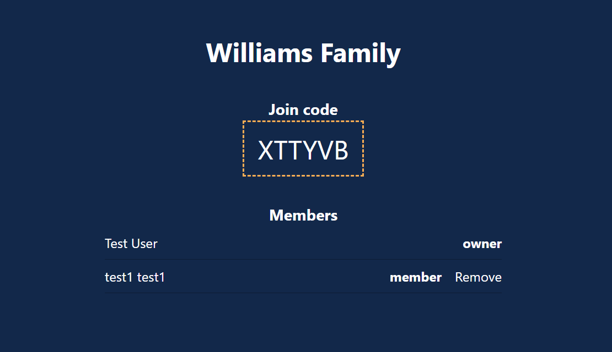
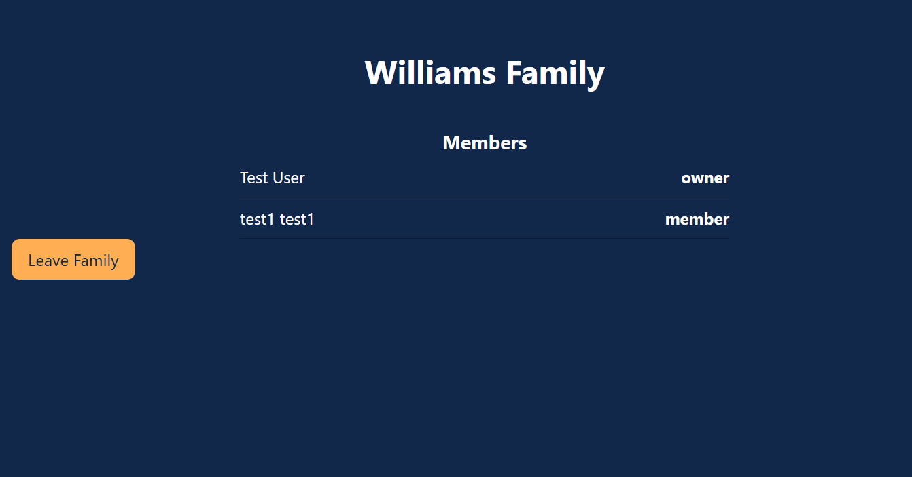
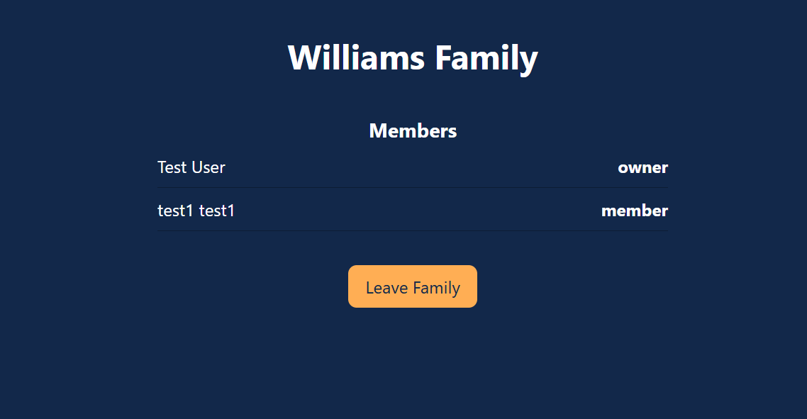
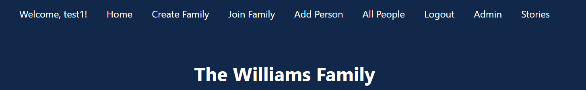

# Sprint 4 - Developing a Refined and Complete System

## Sprint Goals

Develop the system until it is fully featured, with a refined UI and it satisfies the requirements. The system will be fully tested at this point.

### Specific Goals

- Refine the design and UI of the website
- Refine the user experience (UX) of the system
- Perform final, full-system testing

## Testing mobile view

I opened the app on my phone to look at the layout of everything. 

Somethings, like adding a person got quite long and meant lots of scrolling on mobile. 

### Changes / Improvements

Added a details tag so that it is collapsible which makes it look cleaner. 

## Testing admin page visibility  

Log in with a member account and a owner account to see what is displayed in the family admin page 

### Changes / Improvements

The leave family button was off to the side for the member which looked odd so i moved it to the middle.

## Testing Logout button 

Giving my app to my stakeholder, he said it would make sense for the logout button to be the furthest link to the right. 

### Changes / Improvements

I moved the logout button to the furthest right position. 

## Sprint Review

This sprint refined the app and tested the whole system. Testing on a phone showed that the people picker on the story form took up too much room, so I changed it to a collapsible dropdown. Testing the Family Admin page with an owner account and a member account showed the layout needed work, and my stakeholder suggested that Logout should be the furthest link to the right, which I changed.

**Things that did not go as well** - Small errors and invisible buttons that only showed up in testing and the time spent on layout. 